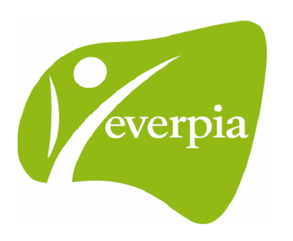

# Projecte 3. Comencem les pràctiques a EverPia

## Taula de continguts

- [Introducció al cas](#introducció-al-cas)
- [Tasques a realitzar](#tasques-a-realitzar)
- [Lliurament del projecte](#lliurament-del-projecte)
- [Avaluació del projecte](#avaluació-del-projecte)
- [Organització del treball](#organització-del-treball)
- [Durada i temporització](#durada-i-temporització)

## Introducció al cas

En aquest tercer projecte intermodular de segon curs comenceu una nova etapa, fer l'estada a l’empresa EverPia.

Benvinguts a EverPia, una consultora IT que té com a missió resoldre els reptes tecnològics de clients molt diversos. Acabeu d’incorporar-vos a l’empresa com alumnes en pràctiques i, com a part del vostre procés de formació, haureu de participar en un projecte real. L’objectiu és que pugueu aplicar els coneixements adquirits al llarg del cicle formatiu i desenvolupar competències professionals en un entorn laboral.

L’origen d’EverPia es remunta a uns anys enrere, quan sis professors van decidir unir les seves forces. Tots ells compartien una passió: la informàtica i l’educació. Però també una convicció profunda: la tecnologia no té sentit si no ajuda a les persones i a les organitzacions a créixer.

Junts van fundar la consultora EverPia, un nom que uneix “ever” (sempre) amb “Pia”, en homenatge a l’esperit educatiu i a la visió de treballar per un futur millor. La seva llegenda comença en una petita sala plena de cables i ordinadors antics, on van jurar: “Mai treballarem sols. Cada projecte serà una oportunitat per créixer junts.”

I què fareu? Treballareu mitjançant control de versions, usant git i GitHub, i aplicareu tècniques de gestió de projectes com Kanban. A més, us introduireu en l’ús professional de la intel·ligència artificial (IA) per millorar la vostra productivitat i generar contingut de qualitat.

Finalment, per posar en pràctica tot el que haureu après, col·laborareu en un projecte real. D'aquesta manera, es podrà comprovar el vostre grau d'assoliment d'aquests coneixements i obrir-vos la porta a una futura incorporació com a consultors júniors.

Una petita empresa client d’EverPia vol millorar la manera com el seu personal protegeix els comptes i la informació. Per això, us encarrega preparar una acció de conscienciació sobre la creació i la gestió de contrasenyes segures i l’ús de l’autenticació multifactor (MFA). El repte no és només explicar conceptes tècnics: cal entendre les necessitats del públic, seleccionar informació fiable i comunicar recomanacions clares i útils a persones que potser no tenen coneixements d’informàtica.

Per donar resposta a l’encàrrec, us organitzareu en equips de dues persones i planificareu la feina amb un tauler Kanban. Fareu servir GitHub per documentar el procés i compartir els resultats; practicareu com donar instruccions precises a les eines d’intel·ligència artificial i com aprofitar Gemini Notebook per treballar amb fonts, generar materials de suport i preparar la presentació. La IA us ajudarà a elaborar esborranys, però l’equip serà responsable de comprovar les fonts, corregir possibles errors i adaptar el contingut al client.

El projecte culminarà amb una presentació de la proposta de conscienciació. Haureu de defensar les recomanacions amb criteri, explicar-les amb claredat i demostrar que sabeu combinar coneixements tècnics, treball en equip, documentació i comunicació professional.

## Tasques a realitzar

- Tasca 1. [Creació tauler Kanban al projecte](./activitats/Tasca1-Kanban.md).
- Tasca 2. [Ús de GitHub. Creació del repositori](./activitats/Tasca2-GitHub.md).
- Tasca 3. [IA Prompting masterclass](./activitats/Activitat_prompt_engineering.md).
- Tasca 4. [Ús de Gemini Notebook](./activitats/Activitat_GeminiNotebook.md).
- Tasca 5. Generació material d'estudi amb Gemini Notebook.
- Tasca 6. Presentació conscienciació ús contrasenyes i MFA.

## Lliurament del projecte

Cal penjar el repositori del projecte 3 a la tasca corresponent del Moodle. Assegureu-vos que el repositori sigui **privat** i que els **professors del projecte estiguin afegits com a col·laboradors**.

El repositori ha de contenir les tasques que s'indiquen a l'enunciat de l'activitat. Cada tasca ha d'estar documentada amb un fitxer `Markdown` i amb els fitxers corresponents a cada tasca.

## Avaluació del projecte

El conjunt de tasques que s'avaluaran en aquest projecte són les següents:

| Tasques individuals          | Tasques en grup          |
|--------------------          |----------------          |
| Tasca 2: Repositori GitHub   | Tasca 1: Seguiment Kanban|
| Tasca 5: Gemini Notebook     | Tasca 6: Presentació     |
| Tasca 6: Presentació ind.    |                          |

La nota final del projecte es calcularà amb la següent fórmula:

$$
\text{Nota final} = 0,25 \cdot \text{Tasca 2} + 0,20 \cdot \text{Tasca 5} + 0,10 \cdot \text{Tasca 6 individual} + 0,20 \cdot \text{Tasca 1} + 0,25 \cdot \text{Tasca 6 grupal}
$$

## Organització del treball

En aquest projecte es treballarà en grups de 2 persones. Hi haurà activitats individuals i activitats en grup. Cada membre del grup haurà de documentar les activitats individuals i les de grup en el seu repositori GitHub. Òbviament, el contingut de les activitats en grup serà el mateix per a tots dos membres del grup.

## Durada i temporització

El projecte té una durada de **18 hores**, repartides en 9 sessions de 2 hores. La temporització de les sessions és la següent:

| Sessió  | Data       | Contingut                                    |
|-------- |------      |-----------                                   |
|1        | 16/10/2026 | Presentació i creació del tauler Kanban.     |
|2        | 19/10/2026 | Activitat GitHub.                            |
|3        | 20/10/2026 | Activitat IA Prompting masterclass.          |
|4        | 23/10/2026 | Activitat Gemini Notebook. Seguiment Kanban. |
|5        | 26/10/2026 | Activitat Gemini Notebook: material d'estudi.|
|6        | 27/10/2026 | Activitat Gemini Notebook: material d'estudi.|
|7        | 30/10/2026 | Gestió repositori. Seguiment Kanban.         |
|8        | 03/11/2026 | Preparar presentació Seguretat Informàtica.  |
|9        | 06/11/2026 | Presentacions Seguretat Informàtica.         |
