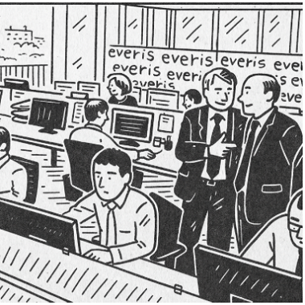
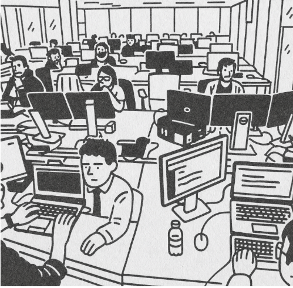

# Plantilla projecte intermodular

## Taula de continguts

- [Introducció al cas](#introducció-al-cas)
- [Compentències profesionals](./documents/Comp.md)
- [Resultats d'aprenentatge](./documents/RA.md)
- [Tasques a realitzar](#tasques-a-realitzar)
- [Lliurament del projecte](#lliurament-del-projecte)

## Introducció al cas

Benvinguts a EverPia, una consultora IT que té com a missió resoldre els reptes tecnològics de clients molt diversos. Acabeu d’incorporar-vos a l’empresa com a nous consultors júnior i, a partir d’avui, formareu part de l’equip que dona servei a diferents organitzacions. Cada client té les seves necessitats concretes i, sovint, semblen projectes inconnexos. Però no us enganyeu: el que realment us demanem és capacitat d’adaptació, visió global i organització.

L’origen d’EverPia es remunta a uns anys enrere, quan vuit professors —Rubén, Isabel, Carlos Alonso, Cristian, Carles Fugarolas, Cristina i Núria— van decidir unir les seves forces. Tots ells compartien una passió: la informàtica i l’educació. Però també una convicció profunda: la tecnologia no té sentit si no ajuda a les persones i a les organitzacions a créixer.

- El Rubén, el rei de la web.
- La Isabel, experta en auditories.
- El Carlos Alonso, .
- El Cristian, explorador de nous reptes.
- El Carles Fugarolas, mestre de servidors i xarxes.
- La Cristina, experta en desenvolupament de software.
- La Núria, creadora d’idees i projectes.

Junts van fundar la consultora EverPia, un nom que uneix “ever” (sempre) amb “Pia”, en homenatge a l’esperit educatiu i a la visió de treballar per un futur millor. La seva llegenda comença en una petita sala plena de cables i ordinadors antics, on van jurar: *“Mai treballarem sols. Cada projecte serà una oportunitat per créixer junts.”*

Ara sou vosaltres qui entreu a formar part d’aquesta història. Acabeu de ser contractats com a consultors júnior d’EverPia i us enfrontareu a reptes reals, provinents de clients molt diferents.

Cada encàrrec pot semblar independent, però tots formen part d’una mateixa aventura: demostrar que sou capaços de treballar amb professionalitat, rigor i esperit col·laboratiu.

El repte és clar: aprendre a funcionar com a consultora. Això implica no només resoldre problemes tècnics, sinó també organitzar-vos, planificar i documentar. A EverPia es treballa amb la metodologia Kanban, utilitzant l’eina Planner, i es valora moltíssim mantenir el backlog de tasques al dia. Aquesta serà la clau de l’èxit en tots els projectes que us encarreguin.

Les tasques que us esperen són diverses: des de crear el vostre compte a GitHub i començar a documentar-vos amb Markdown, fins a seleccionar un SAI per protegir una empresa de talls elèctrics, recuperar l’accés a un sistema bloquejat, configurar un servidor Linux, desplegar serveis de xarxa com el DHCP, reflexionar sobre la sostenibilitat en l’àmbit tecnològic, o desenvolupar una pàgina web.

L’objectiu últim és que desenvolupeu les vostres competències tècniques i professionals, però també que experimenteu el que significa ser part d’una consultora: treballar en equip, afrontar imprevistos, comunicar-vos amb claredat i entregar productes que reflecteixin qualitat i compromís.

En definitiva, aquest projecte és la vostra porta d’entrada a EverPia: la consultora nascuda de la passió d’uns professors, i que ara posa en les vostres mans la responsabilitat d’escriure el següent capítol de la seva història.

## Tasques a realitzar

- Tasca 1
- Tasca 2
...

## Lliurament del projecte

A la pàgina README.md completeu les dades que es demanen. Crear les carpetes corresponents a les tasques demanades i a dins crear un README.md presentant l'activitat i un arxiu solucio.md amb la solució elaborada.

Les imatges que s'incorporin han d'estar dins una carpeta `/img` i si cal incorporar diagrames, esquemes, etc. es recomana que feu servir el format mermaid, tot i que també podeu incorporar imatges amb el format png o jpg si ho preferiu.
