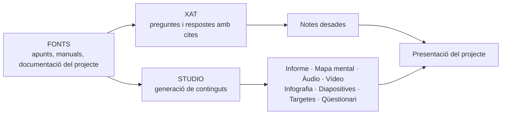

# NotebookLM: dels apunts i manuals als continguts de la presentació del projecte

## Presentació de l'activitat

S'acosta el moment de presentar el Projecte 3 al client d'EverPia. Teniu molta informació repartida: la documentació que heu escrit a GitHub, els apunts dels mòduls, manuals oficials, potser algun vídeo. Convertir tot això en una presentació clara demana temps, i aquí és on entra **NotebookLM**, el quadern d'IA de Google que funciona amb Gemini.

La diferència amb un xat d'IA normal és important: NotebookLM **només treballa amb les fonts que vosaltres hi pugeu** i cada resposta porta **cites** que enllacen amb el fragment exacte d'on surt la informació. Això el fa molt útil per treballar amb apunts i manuals, perquè es pot comprovar d'on ve cada afirmació.

En aquesta activitat creareu el quadern de l'equip, hi afegireu les fonts del projecte, les interrogareu i generareu diversos continguts (informe, mapa mental, resum d'àudio, infografia, diapositives, targetes i qüestionari) que us serviran de base per preparar la presentació. Hi aplicareu els prompts de la biblioteca que vau crear a l'activitat de prompt engineering.

### Durada de l'activitat

La durada prevista de l'activitat és 2 hores a classe: 30 minuts d'explicació i demostració i 90 minuts de pràctica.

### Objectius específics de l'activitat

- Entendre què és una IA fonamentada en fonts i en què es diferencia d'un xat d'IA generalista.
- Crear un quadern a NotebookLM i seleccionar-hi fonts fiables i variades del projecte.
- Interrogar les fonts i comprovar les respostes a través de les cites.
- Generar continguts en diversos formats i personalitzar-los amb prompts.
- Validar els continguts generats i planificar com s'aprofitaran a la presentació del projecte.

### Competències treballades

j) Elaborar documentació tècnica i administrativa del sistema, complint les normes i reglamentació del sector, per al seu manteniment i l'assistència al client.

n) Mantenir un esperit constant d'innovació i actualització en l'àmbit del sector informàtic.

o) Utilitzar els mitjans de consulta disponibles, seleccionant-ne el més adequat en cada cas, per resoldre en temps raonable supòsits no coneguts i dubtes professionals.

q) Complir amb els objectius de la producció, col·laborant amb l'equip de treball i actuant conforme als principis de responsabilitat i tolerància.

### Resultats d'aprenentatge i criteris d'avaluació

**1713 Projecte intermodular**

RA2. Planteja solucions a les necessitats del sector tenint en compte la seva viabilitat, els costos associats i elaborant un petit projecte.

- 2.3 Obté la informació relativa a les solucions plantejades.
- 2.9 Defineix i elabora la documentació per al seu disseny.
- 2.11 Presenta en públic les idees més rellevants dels projectes proposts.

RA4. Realitza el seguiment de l'execució de les activitats plantejades, verificant que es compleix amb la planificació.

- 4.2 Verifica la qualitat dels resultats de les activitats.

RA5. Transmet informació amb claredat, de manera ordenada i estructurada.

- 5.1 Manté una actitud ordenada i metòdica en la transmissió de la informació.
- 5.3 Transmet informació entre els membres del grup utilitzant mitjans informàtics.

### Continguts

- IA fonamentada en fonts: què és NotebookLM i quan convé fer-lo servir.
- Parts de l'eina: Fonts, Xat i Studio.
- Tipus de fonts admeses i criteris per triar-les.
- El xat amb cites: com es comprova una resposta.
- Continguts que es poden generar: informes, mapa mental, resum d'àudio, resum de vídeo, infografia, presentació de diapositives, targetes, qüestionari i taula de dades.
- Personalització dels continguts amb prompts.
- Validació, privadesa i ús responsable.

### Capacitats clau treballades

- Autonomia
- Organització del treball
- Treball en equip
- Innovació
- Responsabilitat

### Semàfor ús de la IA

🔵 Ús obligatori

La IA forma part explícita de l'objectiu d'aprenentatge. Has d'utilitzar-la, analitzar-la, comparar-la o auditar-la seguint instruccions concretes.

**Condicions**: feu servir NotebookLM amb el compte del centre. No hi pugeu documents amb dades personals, contrasenyes ni informació confidencial. Els continguts generats són **material de treball**: la presentació final l'ha de construir i defensar l'equip, i no es pot presentar tal qual cap resum d'àudio, vídeo o joc de diapositives generat per l'eina.

## Enunciat de l'activitat

### Requeriments previs

- Haver fet l'activitat de prompt engineering i tenir la biblioteca de prompts de l'equip.
- Tenir la documentació del Projecte 3 al repositori de GitHub de l'equip.
- Tenir els apunts i manuals dels mòduls implicats en format digital (PDF, document de Google o adreça web).
- Poder accedir a NotebookLM amb el compte del centre.

### Part 1. Explicació i demostració (30 minuts)

#### 1.1 Què és NotebookLM?

És un quadern de treball amb IA. Vosaltres hi pugeu documents (les **fonts**) i l'eina es converteix en un expert en aquell material: en fa resums, respon preguntes i el transforma en altres formats.

| | Xat d'IA generalista (Gemini, ChatGPT…) | NotebookLM |
| :--- | :--- | :--- |
| D'on treu la informació | Del seu entrenament i, a vegades, d'internet | De les fonts que hi heu pujat |
| Cites | No sempre | Sí, cada resposta enllaça amb el fragment de la font |
| Risc d'inventar | Més alt | Més baix, però no zero |
| Ideal per a | Idees, esborranys, dubtes generals | Treballar a fons un material concret |

#### 1.2 Les tres zones de l'eina



- **Fonts**: admet PDF, documents i presentacions de Google, fitxers de text i Markdown, adreces web, vídeos de YouTube, àudio i text enganxat. Es poden activar i desactivar per decidir amb quines treballa en cada moment.
- **Xat**: hi fem preguntes. Cada resposta porta números de cita; en fer-hi clic veiem el fragment original. Les respostes útils es poden desar com a nota.
- **Studio**: genera continguts a partir de les fonts. Abans de generar-los es poden personalitzar amb un prompt (tema, públic, to, durada, idioma).

Les opcions disponibles poden variar segons el compte i la versió de l'eina.

#### 1.3 Quin contingut serveix per a què?

| Contingut | Què genera | Com ens ajuda a la presentació |
| :--- | :--- | :--- |
| **Informe** | Document de síntesi, guia d'estudi o resum executiu | Base del guió i del text de les diapositives |
| **Mapa mental** | Esquema ramificat dels conceptes | Decidir l'estructura i l'ordre de la presentació |
| **Resum d'àudio** | Conversa tipus pòdcast sobre les fonts | Repassar i escoltar com s'explica el projecte amb paraules senzilles |
| **Resum de vídeo** | Vídeo narrat amb diapositives | Idees per al fil narratiu i els recursos visuals |
| **Infografia** | Imatge resum | Inspiració per a una diapositiva visual |
| **Presentació de diapositives** | Esborrany de diapositives | Punt de partida que cal reescriure i adaptar |
| **Targetes i qüestionari** | Preguntes i respostes | Preparar el torn de preguntes de la defensa |
| **Taula de dades** | Taula comparativa | Comparar opcions (per exemple, models o costos) |

#### 1.4 Bones pràctiques

- **La qualitat depèn de les fonts.** Si hi pugeu un document amb errors, la IA els repetirà. Trieu fonts fiables: documentació oficial, apunts del mòdul i la vostra documentació revisada.
- **Comproveu les cites.** Que hi hagi una cita no vol dir que la interpretació sigui correcta: obriu-la i llegiu el fragment.
- **Personalitzeu sempre.** Un contingut generat sense instruccions és genèric. Indiqueu-hi públic, objectiu i to, tal com vau aprendre a l'activitat de prompt engineering.
- **Respecteu la privadesa i els drets d'autor.** Pugeu-hi només material que tingueu dret a fer servir i que no contingui dades sensibles.

### Part 2. Pràctica (90 minuts)

Treballeu amb el vostre equip de projecte i aneu omplint el fitxer `solucio.md`.

**Pas 1. Creeu el quadern i afegiu-hi les fonts (15 minuts)**

1. Entreu a [notebooklm.google.com](https://notebooklm.google.com) amb el compte del centre i creeu un quadern anomenat `EverPia - Projecte 3 - [nom de l'equip]`.
2. Afegiu-hi **com a mínim cinc fonts de tres tipus diferents**:
   - la vostra documentació del projecte (els fitxers `README.md` i `solucio.md` del repositori);
   - apunts del mòdul o mòduls implicats;
   - un manual o documentació oficial de la tecnologia que heu fet servir;
   - opcionalment, un vídeo de YouTube o una pàgina web de referència.
3. Compartiu el quadern amb tots els membres de l'equip i amb el professorat.
4. Ompliu la taula de fonts:

| Núm. | Font | Tipus | Per què és fiable? |
| :-: | :--- | :--- | :--- |
| 1 | | | |
| 2 | | | |
| 3 | | | |
| 4 | | | |
| 5 | | | |

**Pas 2. Interrogueu les fonts (15 minuts)**

1. Feu quatre preguntes al xat sobre el vostre projecte. Com a mínim una ha de relacionar dues fonts (per exemple: "Compara com hem configurat el servei a la nostra documentació amb el que recomana el manual oficial").
2. A cada resposta, obriu dues cites i comproveu que el fragment original diu realment el que afirma la IA.
3. Feu una cinquena pregunta sobre un tema que **no** aparegui a les fonts. Què respon?
4. Deseu com a nota les dues respostes més útils.

| Pregunta | Resum de la resposta | Fonts citades | Les cites són correctes? |
| :--- | :--- | :--- | :-: |
| | | | |

**Pas 3. Genereu continguts al Studio (35 minuts)**

Genereu aquests **quatre continguts obligatoris** de la taula del punt 1.3 (podeu llançar-ne diversos alhora, perquè alguns triguen uns minuts):

- un **informe** que serveixi de base per al guió;
- un **mapa mental** amb l'estructura del projecte;
- un **resum d'àudio** en català, personalitzat amb un prompt;
- unes **targetes** o un **qüestionari** per preparar el torn de preguntes.

Si us queda temps, genereu-ne un cinquè a triar: una infografia, una presentació de diapositives, un resum de vídeo o una taula de dades.

Per personalitzar-los, adapteu les plantilles de la vostra biblioteca de prompts. Per exemple, per al resum d'àudio:

```text
Públic: la gerent d'una petita empresa client d'EverPia, sense coneixements
d'informàtica.
Objectiu: que entengui quin problema tenia, quina solució hem implantat
i quins beneficis en traurà.
To: proper i professional, en català. Eviteu les sigles sense explicar.
Centreu-vos en la nostra documentació del projecte; feu servir el manual
oficial només per aclarir conceptes.
Durada: breu.
```

Anoteu per a cada contingut el prompt de personalització que heu fet servir i feu-ne una captura.

**Pas 4. Valideu els resultats (15 minuts)**

Reviseu amb esperit crític dos dels continguts generats i ompliu la taula. Busqueu errors, imprecisions, coses que falten o explicacions massa genèriques.

| Contingut revisat | Què hi heu detectat | Com ho heu comprovat | Què hi canviareu |
| :--- | :--- | :--- | :--- |
| | | | |
| | | | |
| | | | |

**Pas 5. Planifiqueu la presentació (10 minuts)**

Decidiu què aprofitareu de cada contingut i qui se n'encarrega.

| Part de la presentació | Contingut de NotebookLM que hi ajuda | Què hi afegirà l'equip | Responsable |
| :--- | :--- | :--- | :--- |
| Presentació del client i del problema | | | |
| Solució implantada | | | |
| Demostració o resultats | | | |
| Conclusions i torn de preguntes | | | |

### Què cal lliurar, on i com?

**Què**: una carpeta `activitat-notebooklm` amb dos fitxers:

- `README.md`: presentació breu de l'activitat i enllaç al quadern compartit.
- `solucio.md`: les taules dels passos 1, 2, 4 i 5, els prompts de personalització del pas 3 amb una captura de cada contingut generat, i una reflexió final de l'equip (5-8 línies): què us ha estat més útil, què no, i en què es diferencia de treballar amb un xat d'IA generalista.

**On**: al repositori de GitHub de l'equip del Projecte 3. El quadern de NotebookLM ha d'estar compartit amb el professorat.

**Com**: en format Markdown. Les captures i el mapa mental exportat han d'estar a la carpeta `/img`. Un lliurament per equip; actualitzeu també la tasca corresponent al tauler Kanban.

## Material de suport

- [NotebookLM](https://notebooklm.google.com)
- [Centre d'ajuda de NotebookLM](https://support.google.com/notebooklm)
- [Semàfor d'IA de l'Escola Pia Mataró](https://sites.google.com/mataro.epiaedu.cat/semafor-ia): què vol dir cada nivell d'ús de la IA.
- Biblioteca de prompts de l'equip (activitat de prompt engineering).
- [Documentació de Mermaid](https://mermaid.js.org/) per als diagrames en Markdown.
