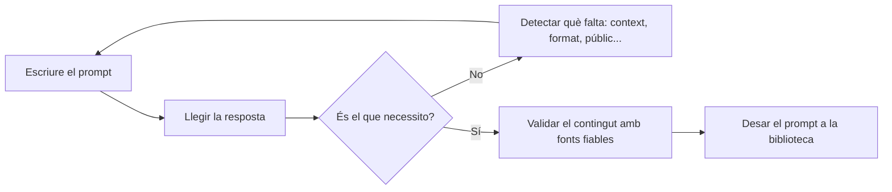

# Prompt engineering i metaprompts: aprendre a demanar bé a la IA

## Presentació de l'activitat

Estem aprenent metodologia de projectes. Les eines d'IA generativa (Gemini, Copilot, ChatGPT, Claude…) poden estalviar moltes hores en aquesta feina, però només si se'ls sap demanar bé les coses. Un encàrrec vague dona una resposta vaga; un encàrrec precís dona un esborrany útil.

En aquesta sessió treballarem el **prompt engineering**: la manera d'escriure instruccions clares perquè la IA generi continguts de qualitat. Veurem de quines parts consta un bon prompt, quines tècniques funcionen millor i què és un **metaprompt** (un prompt que serveix per crear o millorar altres prompts). Ho aplicarem directament al vostre projecte: en acabar tindreu una **biblioteca de prompts de l'equip** que fareu servir per preparar els continguts de la presentació del Projecte 3.

### Durada de l'activitat

La durada prevista de l'activitat és 2 hores a classe: 50 minuts de teoria i 70 minuts de pràctica guiada.

### Objectius específics de l'activitat

- Identificar els elements d'un prompt eficaç (rol, context, tasca, format, públic i restriccions) i detectar quins falten en un prompt fluix.
- Aplicar tècniques bàsiques de prompt engineering: exemples (*few-shot*), pas a pas i millora iterativa.
- Entendre què és un metaprompt i fer-ne servir per generar i millorar prompts.
- Crear una biblioteca de prompts reutilitzables per als continguts de la presentació del projecte.
- Validar de manera crítica els resultats de la IA abans d'incorporar-los a la documentació.

### Competències treballades

j) Elaborar documentació tècnica i administrativa del sistema, complint les normes i reglamentació del sector, per al seu manteniment i l'assistència al client.

m) Organitzar i desenvolupar el treball assignat mantenint unes relacions professionals adequades en l'entorn de treball.

n) Mantenir un esperit constant d'innovació i actualització en l'àmbit del sector informàtic.

o) Utilitzar els mitjans de consulta disponibles, seleccionant-ne el més adequat en cada cas, per resoldre en temps raonable supòsits no coneguts i dubtes professionals.

r) Adaptar-se a diferents llocs de treball i noves situacions laborals originats per canvis tecnològics i organitzatius en els processos productius.

### Resultats d'aprenentatge i criteris d'avaluació

**1713 Projecte intermodular**

RA2. Planteja solucions a les necessitats del sector tenint en compte la seva viabilitat, els costos associats i elaborant un petit projecte.

- 2.3 Obté la informació relativa a les solucions plantejades.
- 2.4 Identifica aspectes innovadors que puguin ser d'aplicació.
- 2.9 Defineix i elabora la documentació per al seu disseny.

RA5. Transmet informació amb claredat, de manera ordenada i estructurada.

- 5.1 Manté una actitud ordenada i metòdica en la transmissió de la informació.
- 5.3 Transmet informació entre els membres del grup utilitzant mitjans informàtics.
- 5.4 Coneix els termes tècnics en altres llengües que siguin estàndards del sector.

### Continguts

- Què és un prompt i com "entén" una IA generativa el que li demanem.
- Anatomia d'un prompt eficaç: rol, context, tasca, format, públic i restriccions.
- Tècniques: instrucció directa (*zero-shot*), amb exemples (*few-shot*), pas a pas i millora iterativa.
- Metaprompts: generador, entrevistador i millorador de prompts. Plantilles amb variables.
- Límits i riscos: al·lucinacions, biaixos, dades personals i confidencials.
- Validació dels resultats i registre de prompts.

### Capacitats clau treballades

- Autonomia
- Organització del treball
- Treball en equip
- Innovació
- Resolució de problemes
- Responsabilitat

### Semàfor ús de la IA

🔵 Ús obligatori

La IA forma part explícita de l'objectiu d'aprenentatge. Has d'utilitzar-la, analitzar-la, comparar-la o auditar-la seguint instruccions concretes.

**Condicions**: feu servir l'eina amb el compte del centre. No hi introduïu dades personals, contrasenyes ni informació confidencial. Cal guardar tots els prompts utilitzats i les respostes obtingudes (registre de prompts), perquè formen part del lliurament.

## Enunciat de l'activitat

### Requeriments previs

- Tenir accés a una eina d'IA generativa amb el compte del centre.
- Tenir el repositori de l'equip del Projecte 3 a GitHub amb la documentació de les tasques fetes fins ara.
- Tenir a mà els apunts i manuals dels mòduls implicats en el projecte.

### Part 1. Teoria (50 minuts)

#### 1.1 Què és un prompt?

Un **prompt** és la instrucció que donem a una eina d'IA generativa. La IA no "sap" què volem: genera la resposta més probable a partir del text que rep. Per això, tot el que no li expliquem s'ho ha d'inventar o ho resol de la manera més genèrica possible.

Penseu-hi com si fos un company nou que acaba d'arribar a EverPia: és molt capaç, però no coneix el client, ni el projecte, ni què espereu d'ell. Si li dieu "fes-me un resum del DHCP", us farà un resum qualsevol. Si li expliqueu per a qui és, per a què servirà i quin format voleu, us farà el que necessiteu.

#### 1.2 Anatomia d'un prompt eficaç

Un bon prompt respon sis preguntes:

| Element | Pregunta que respon | Exemple |
| :--- | :--- | :--- |
| **Rol** | Qui ha de ser la IA? | "Actua com a tècnic de sistemes sènior d'una consultora IT." |
| **Context** | Quina és la situació? | "Hem instal·lat un servidor DHCP amb Ubuntu Server per a una gestoria de 12 treballadors." |
| **Tasca** | Què ha de fer exactament? | "Explica què fa el servei i quins avantatges té per al client." |
| **Format** | Com ha de ser el resultat? | "Tres paràgrafs curts i una taula amb dues columnes: abans / després." |
| **Públic i to** | Per a qui és? | "Per a la gerent de la gestoria, que no és informàtica. To proper i professional, en català." |
| **Restriccions** | Què ha d'evitar o respectar? | "Màxim 150 paraules. Sense sigles sense explicar. Si no saps una dada, digues-ho." |

No sempre calen tots sis, però com més n'hi hagi, menys ha d'endevinar la IA.

**Prompt fluix**

```text
Fes-me un resum del DHCP.
```

**Prompt complet**

```text
Actua com a tècnic de sistemes sènior d'una consultora IT.
Hem instal·lat un servidor DHCP amb Ubuntu Server per a una gestoria de
12 treballadors que fins ara configurava les adreces IP a mà.
Explica què fa aquest servei i quins avantatges té per al client.
Escriu-ho per a la gerent, que no és informàtica: to proper i professional,
en català, sense sigles sense explicar.
Format: tres paràgrafs curts i, al final, una taula "Abans / Després".
Màxim 150 paraules. Si et falta alguna dada, pregunta-me-la abans d'escriure.
```

#### 1.3 Tècniques que funcionen

- **Instrucció directa (*zero-shot*)**: demanem la tasca sense exemples. Serveix per a encàrrecs senzills.
- **Amb exemples (*few-shot*)**: enganxem un o dos exemples del resultat que volem ("escriu-ho amb aquest mateix estil"). És la millor manera d'aconseguir que tota la documentació de l'equip tingui el mateix to.
- **Pas a pas**: demanem que primer plantegi l'esquema i, quan l'hàgim validat, que el desenvolupi. Dividir una feina gran en passos petits dona resultats molt millors que demanar-ho tot de cop.
- **Delimitadors**: separem les instruccions del material amb marques clares (`"""text"""`, `<apunts>…</apunts>`), perquè la IA no confongui què és ordre i què és contingut.
- **Millora iterativa**: el primer resultat gairebé mai és el definitiu. Llegim, detectem què falla i afinem el prompt.



#### 1.4 Metaprompts: prompts per fer prompts

Un **metaprompt** és un prompt que té com a resultat un altre prompt. En lloc de demanar el contingut directament, demanem a la IA que ens ajudi a escriure la millor instrucció possible. Hi ha tres patrons bàsics:

**a) Generador**: la IA escriu el prompt per nosaltres.

```text
Ets un expert en prompt engineering.
Escriu el millor prompt possible perquè una IA generi [QUÈ VULL].
El prompt ha d'incloure rol, context, tasca, format, públic i restriccions.
Retorna només el prompt, dins d'un bloc de codi.
```

**b) Entrevistador**: la IA ens pregunta el que necessita saber abans d'escriure.

```text
Vull crear un prompt per generar [QUÈ VULL].
Abans d'escriure'l, fes-me d'una en una les preguntes que necessitis
per conèixer el context, el públic i el format.
Quan tinguis prou informació, escriu el prompt final.
```

**c) Millorador**: la IA revisa un prompt nostre.

```text
Aquest és el meu prompt:
"""
[EL MEU PROMPT]
"""
Analitza'l: digues quins elements hi falten (rol, context, tasca, format,
públic, restriccions) i quines parts són ambigües.
Després reescriu-lo millorat i explica'm en tres punts què has canviat.
```

Les paraules entre claudàtors són **variables**: només cal canviar-les per reutilitzar la plantilla en una altra tasca. Un prompt amb variables és una eina de l'equip, no un missatge d'un sol ús.

#### 1.5 Límits i bones pràctiques

- **La IA s'equivoca amb molta seguretat.** Pot inventar ordres, paràmetres, versions o dades (al·lucinacions). Tot contingut tècnic s'ha de comprovar amb els apunts, la documentació oficial o una prova real al vostre servidor.
- **No hi poseu dades sensibles.** Ni contrasenyes, ni dades personals, ni configuracions reals d'un client.
- **El responsable del resultat sou vosaltres.** Si un error arriba a la presentació, l'error és de l'equip, no de la IA.
- **Guardeu els prompts.** Un bon prompt es pot tornar a fer servir; i el registre demostra com heu treballat.

### Part 2. Pràctica guiada (70 minuts)

Treballeu amb el vostre equip de projecte. Feu servir Gemini amb el compte del centre (o l'eina que indiqui el professorat) i aneu omplint el fitxer `solucio.md`.

**Exercici 1. Diagnòstic (10 minuts)**

Marqueu amb una ✗ els elements que falten a cadascun d'aquests prompts.

| Prompt | Rol | Context | Tasca | Format | Públic | Restriccions |
| :--- | :-: | :-: | :-: | :-: | :-: | :-: |
| "Explica'm què és un SAI." | | | | | | |
| "Fes una presentació del nostre projecte." | | | | | | |
| "Ets un tècnic. Escriu com es configura un servidor Linux." | | | | | | |

**Exercici 2. Del prompt fluix al prompt complet (15 minuts)**

1. Trieu una de les tasques tècniques que heu fet al Projecte 3.
2. Escriviu un prompt fluix (una sola frase) per demanar una explicació d'aquesta tasca per al client. Executeu-lo i deseu la resposta.
3. Reescriviu-lo amb els sis elements de la taula del punt 1.2. Executeu-lo en un xat nou i deseu la resposta.
4. Compareu els dos resultats: quines tres diferències hi veieu?

**Exercici 3. Amb exemples (10 minuts)**

Copieu un fragment de la vostra pròpia documentació (un `solucio.md` d'una tasca anterior) i feu-lo servir com a exemple d'estil: demaneu a la IA que redacti, amb el mateix to i la mateixa estructura, la introducció d'una altra tasca del projecte. Feu servir delimitadors per separar l'exemple de la instrucció.

**Exercici 4. Metaprompt (15 minuts)**

1. Feu servir el metaprompt **entrevistador** per crear un prompt que generi el guió oral (2 minuts) amb què presentareu una de les tasques del projecte.
2. Responeu les preguntes que us faci la IA i deseu el prompt final que us proposi.
3. Passeu el prompt de l'exercici 2 pel metaprompt **millorador**. Què hi ha canviat? Hi esteu d'acord?

**Exercici 5. Biblioteca de prompts de l'equip (15 minuts)**

Creeu quatre plantilles reutilitzables, amb variables entre claudàtors, per preparar la presentació del projecte:

| Núm. | Plantilla | Per a què servirà |
| :-: | :--- | :--- |
| 1 | Guió oral d'una tasca | Text de 2 minuts per explicar una tasca davant del client. |
| 2 | Estructura de diapositives | Títol i tres idees clau per a cada diapositiva de la presentació. |
| 3 | Preguntes difícils | Deu preguntes que us podria fer el client o el professorat, amb pistes de resposta. |
| 4 | Glossari tècnic | Termes tècnics del projecte amb la definició i l'equivalent en anglès. |

Proveu-ne com a mínim dues i ajusteu-les fins que el resultat us serveixi.

**Exercici 6. Validació (5 minuts)**

Trieu tres afirmacions tècniques de qualsevol de les respostes obtingudes i comproveu-les amb els apunts o amb la documentació oficial. Ompliu la taula:

| Afirmació de la IA | Font amb què l'heu comprovat | Correcta? | Correcció |
| :--- | :--- | :-: | :--- |
| | | | |

### Què cal lliurar, on i com?

**Què**: una carpeta `activitat-prompt-engineering` amb dos fitxers:

- `README.md`: presentació breu de l'activitat (què heu treballat i amb quina eina).
- `solucio.md`: les taules dels exercicis 1 i 6, els prompts i un resum de les respostes dels exercicis 2, 3 i 4, la biblioteca de prompts de l'exercici 5 i una reflexió final de l'equip (5-8 línies): què heu après i què fareu diferent a partir d'ara.

**On**: al repositori de GitHub de l'equip del Projecte 3.

**Com**: en format Markdown. Els prompts han d'anar dins de blocs de codi. Si hi afegiu captures, deseu-les a la carpeta `/img`. Un lliurament per equip, abans d'acabar la sessió; actualitzeu també la tasca corresponent al tauler Kanban.

## Material de suport

- [Semàfor d'IA de l'Escola Pia Mataró](https://sites.google.com/mataro.epiaedu.cat/semafor-ia): què vol dir cada nivell d'ús de la IA.
- [Estratègies de disseny de prompts (Google AI)](https://ai.google.dev/gemini-api/docs/prompting-strategies)
- [Guia de prompt engineering (Anthropic)](https://docs.claude.com/en/docs/build-with-claude/prompt-engineering/overview)
- [Learn Prompting](https://learnprompting.org/docs/introduction): curs obert d'introducció.
- [Documentació de Mermaid](https://mermaid.js.org/) per als diagrames en Markdown.
